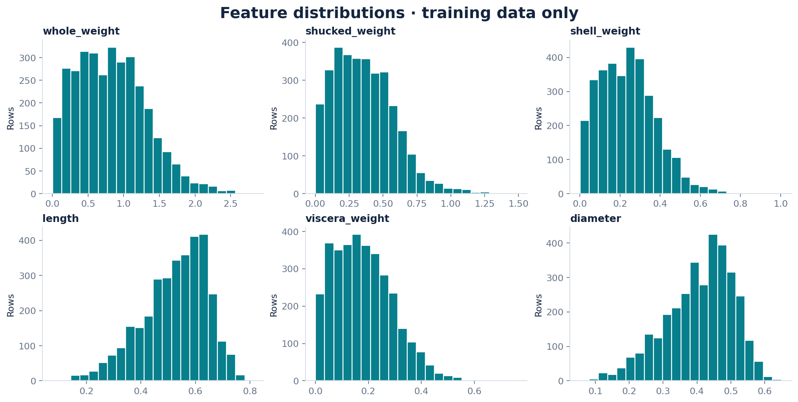
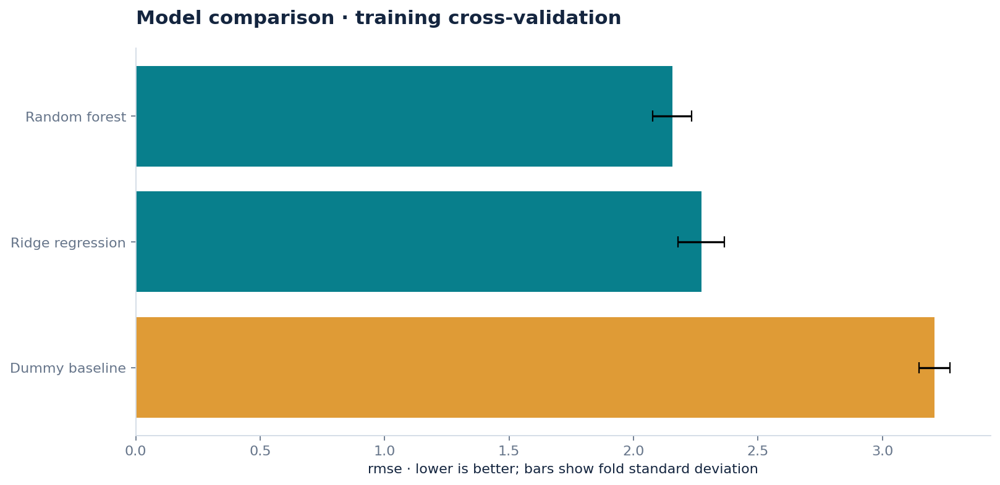
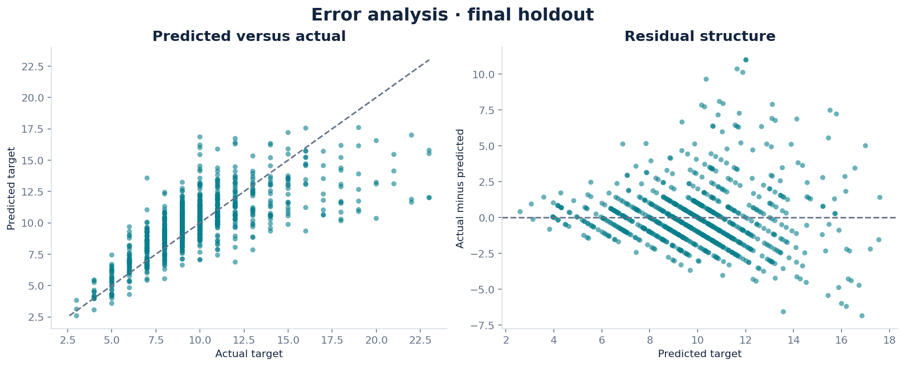
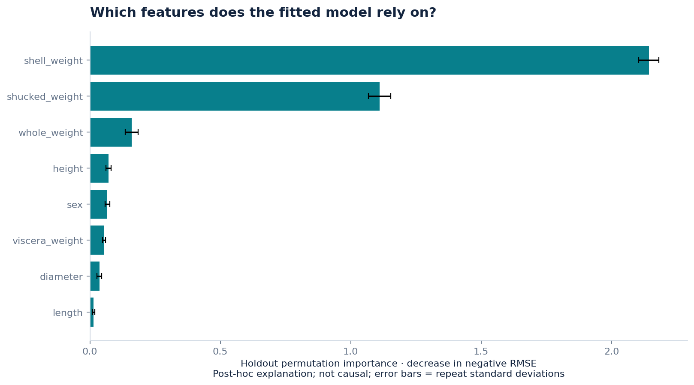

# تقدير عدد حلقات المحار

دراسة انحدار لتقدير عدد الحلقات من القياسات الجسدية، باستخدام 4,177 عينة وثماني خصائص من مجموعة UCI.

اختيرت الغابة العشوائية بتحقق متقاطع من ثلاث طيات على 3,341 عينة تدريب. جرى تقييم 836 عينة محفوظة بعد الاختيار. بلغ أكبر خطأ مطلق 10.9879 حلقة، وحُفظت أكبر 30 حالة خطأ في ملف تحليل الأخطاء.

فاصل الثقة التقريبي لخطأ RMSE هو 2.0368–2.3987 من 200 إعادة أخذ عينات؛ وهو مشروط بالنموذج والتقسيم ولا يشمل عدم يقين التدريب والاختيار. الهدف عدد الحلقات، وليس العمر مباشرةً.

برز وزن الصدفة في أهمية التبديل بزيادة 2.1433 في RMSE، وبلغ ارتباط الطول والقطر 0.987. هذه علاقات رصدية وليست سببية.

**حجم البيانات في هذه النسخة:** 4,177 عينة و8 خصائص.

## النتائج المسجّلة

الأرقام التالية من التنفيذ المحفوظ لهذه النسخة؛ لم تُعَد التجارب أثناء تعريب التوثيق.

### التحقق المتقاطع على التدريب

| النموذج | RMSE — الأقل أفضل | الانحراف المعياري بين الطيات |
| :--- | :--- | :--- |
| **الغابة العشوائية** | **2.1552** | 0.0792 |
| انحدار ريدج | 2.2718 | 0.0931 |
| خط الأساس البسيط | 3.2092 | 0.0615 |

### التقييم النهائي على الاختبار المحفوظ (836 عينة)

| النموذج | RMSE | MAE | R² |
| :--- | :--- | :--- | :--- |
| **الغابة العشوائية** | **2.2241** | **1.5550** | **0.5430** |
| خط الأساس البسيط | 3.2906 | 2.3848 | -0.0003 |

## الرسوم والنتائج المرئية

الرسوم محفوظة من التنفيذ الأصلي. تعريب هذه الصفحة لا يغيّر بياناتها أو تسميات الصور داخل الملفات.

## الملفات المرجعية

- [مقاييس التقييم والنتائج](metrics.json).
- [بيانات التدقيق وبيئة التنفيذ](audit.json).
- [مصدر البيانات وشروط الترخيص](SOURCE.md).
- [سجل أخطاء الاختبار](error_analysis.csv).
- [دفتر شرح التحليل](analysis.ipynb).
- [ملاحظات المراجعة البشرية](LEARNING_NOTES.md).

## المصادر والإسناد

- [مصدر 1: UCI Abalone](https://archive.ics.uci.edu/dataset/1/abalone).

**حالة المراجعة:** المراجعة البشرية ما زالت معلّقة؛ لم تُملأ الملاحظات أو إجابات التعلم تلقائيًا.

[المرجع التقني الإنجليزي الكامل](README.en.md) يحفظ تفاصيل النسخة الأصلية. تُترك أسماء الملفات والأوامر ومعرّفات النماذج والمقاييس بصيغتها التقنية لضمان تطابقها مع الكود.
